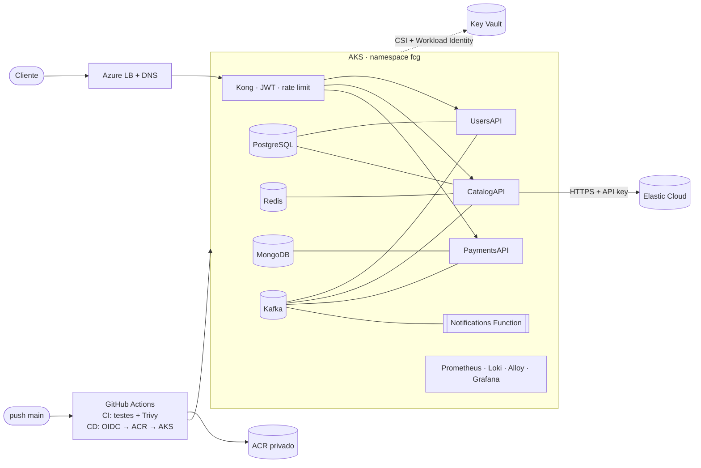

# FIAP Cloud Games — Orquestração (Fase 4: Cloud-Native na Azure)

Repositório central da plataforma **FIAP Cloud Games (FCG)**: arquitetura, infraestrutura como código,
manifests de plataforma, pipelines reutilizáveis, scripts de execução/validação e documentação de entrega.

A FCG é uma loja de jogos em **microsserviços .NET 8 orientados a eventos** (Kafka). A Fase 4 leva a
solução da Fase 3 (Compose + Kubernetes local) para a **Azure**: AKS, ACR privado, Key Vault com Workload
Identity, CI/CD no GitHub Actions com OIDC, **busca avançada com Elasticsearch (Elastic Cloud)** e
persistência poliglota.

> **Estado atual**: ver [docs/phase4/STATUS.md](docs/phase4/STATUS.md). Tudo o que não depende da assinatura
> Azure está implementado e validado (testes, CI real no GitHub, ensaio local dos manifests do AKS). O
> provisionamento real aguarda a liberação da assinatura e a autorização de custo.

## Repositórios

| Repositório | Papel |
|---|---|
| **fiap-cloud-games-orchestration** (este) | Terraform, manifests de plataforma do AKS, Compose, Kong, observabilidade, workflows reutilizáveis, scripts, documentação |
| [fiap-cloud-games-users-api](https://github.com/allanmoraesprado/fiap-cloud-games-users-api) | Identidade: cadastro, login, emissão de JWT, papéis |
| [fiap-cloud-games-catalog-api](https://github.com/allanmoraesprado/fiap-cloud-games-catalog-api) | Jogos, biblioteca, compra, cache Redis, **busca Elasticsearch** |
| [fiap-cloud-games-payments-api](https://github.com/allanmoraesprado/fiap-cloud-games-payments-api) | Pagamentos simulados, histórico no MongoDB |
| [fiap-cloud-games-notifications-function](https://github.com/allanmoraesprado/fiap-cloud-games-notifications-function) | Azure Function (gatilhos Kafka): e-mails simulados |
| [fiap-cloud-games-notifications-api](https://github.com/allanmoraesprado/fiap-cloud-games-notifications-api) | Legado da Fase 2 (somente perfil `phase2-legacy`) |

Os repositórios de serviço devem estar clonados **lado a lado** com este (os builds do Compose e os scripts
usam `../fiap-cloud-games-*`).

## Arquitetura



Detalhes: [docs/phase4/ARCHITECTURE.md](docs/phase4/ARCHITECTURE.md) · eventos e contratos:
[docs/event-flows.md](docs/event-flows.md), [contracts/README.md](contracts/README.md).

## Documentação da Fase 4 (`docs/phase4/`)

| Documento | Conteúdo |
|---|---|
| [STATUS](docs/phase4/STATUS.md) · [PLAN](docs/phase4/PLAN.md) · [REQUIREMENTS](docs/phase4/REQUIREMENTS.md) · [DEPENDENCIES](docs/phase4/DEPENDENCIES.md) | Status por marco, plano, matriz de requisitos, dependências |
| [ARCHITECTURE](docs/phase4/ARCHITECTURE.md) · [DECISIONS](docs/phase4/DECISIONS.md) · [RISKS](docs/phase4/RISKS.md) · [COSTS](docs/phase4/COSTS.md) | Arquitetura, decisões, riscos, custos estimados |
| [PROVISIONING](docs/phase4/PROVISIONING.md) · [DESTROY](docs/phase4/DESTROY.md) | Criação, validação e destruição dos recursos Azure |
| [CICD](docs/phase4/CICD.md) | Pipelines, OIDC, rastreabilidade, live deploy |
| [ELASTICSEARCH](docs/phase4/ELASTICSEARCH.md) | Busca, fuzzy, relevância, sincronização e consistência |
| [DATA](docs/phase4/DATA.md) | PostgreSQL, MongoDB, Redis (medição de impacto) |
| [KEYVAULT](docs/phase4/KEYVAULT.md) | Key Vault, Workload Identity, segredos em runtime |
| [OBSERVABILITY](docs/phase4/OBSERVABILITY.md) | Prometheus, Grafana, Loki, Alloy no AKS |
| [TEST-EVIDENCE](docs/phase4/TEST-EVIDENCE.md) · [CHECKPOINTS](docs/phase4/CHECKPOINTS.md) | Evidências reais e histórico de execução |
| [VIDEO-SCRIPT](docs/phase4/VIDEO-SCRIPT.md) · [FINAL-REPORT](docs/phase4/FINAL-REPORT.md) · [HANDOFF](docs/phase4/HANDOFF.md) | Roteiro do vídeo, relatório de entrega, retomada |

Documentação da Fase 3 (inglês, histórico): [docs/README-phase3.md](docs/README-phase3.md) e demais arquivos de `docs/`.

## Executar localmente (Docker Compose)

Pré-requisitos: Docker Desktop, repositórios irmãos clonados.

```bash
cp .env.example .env              # opcional; o Compose tem padrões de desenvolvimento
docker compose up -d --build      # Postgres, Kafka, Redis, MongoDB, Elasticsearch, 3 APIs, Function, Kong, observabilidade
```

```powershell
.\scripts\smoke-compose.ps1                 # fluxo completo pelo Kong, incluindo a busca
.\scripts\smoke-compose.ps1 -SearchOutage   # + queda e recuperação do Elasticsearch
```

| Serviço | URL |
|---|---|
| Gateway (Kong) | http://localhost:8000 — público: `/api/auth/*`; JWT: `/api/users`, `/api/games` (inclui `/api/games/search`), `/api/library`, `/api/payments` |
| Grafana / Prometheus | http://localhost:3000 (`admin`/`admin`, só local) · http://localhost:9090 |
| Elasticsearch | http://localhost:9200 (somente desenvolvimento) |
| APIs diretas (Swagger) | :8080 Users · :8082 Catalog · :8083 Payments |

Portas configuráveis em `.env` (`*_HOST_PORT`). Credenciais do `.env.example` são **placeholders locais**.
Usuários semeados localmente: `admin@fcg.com / Admin@123`, `user@fcg.com / User@123`.

Kubernetes local (Docker Desktop): `.\k8s\build-images.ps1` e `.\k8s\apply-all.ps1` (gateway em
http://localhost:30080) — ver [docs/kubernetes.md](docs/kubernetes.md).

## Implantar na Azure

Resumo (detalhes e custos em [PROVISIONING.md](docs/phase4/PROVISIONING.md) e [COSTS.md](docs/phase4/COSTS.md)):

```bash
bash scripts/azure/preflight.sh <subscription-id>                  # verificações somente leitura
terraform -chdir=infra/terraform init && terraform -chdir=infra/terraform apply
bash scripts/azure/deploy-platform.sh                              # dados, Kong, observabilidade, identidades
bash scripts/azure/github-variables.sh                             # habilita o CD nos serviços
# push na main de cada serviço (ou "Run workflow") -> build, testes, Trivy, ACR, rolling update, smoke
```

Ensaio local dos manifests do AKS (sem Azure): `bash scripts/azure/simulate-local.sh up --apps` ·
validação estática: `bash scripts/azure/validate-manifests.sh`.

## Segurança

- Nenhum segredo real no Git. Na Azure, credenciais ficam no **Key Vault** e chegam aos pods como arquivos
  (Secrets Store CSI + **Workload Identity**, uma identidade por workload com acesso a segredos individuais);
  nenhum `Secret` do Kubernetes com credenciais; nada sensível no state do Terraform.
- **GitHub Actions → Azure por OIDC** (sem segredos no GitHub); deploy restrito à branch `main` e ao namespace `fcg`.
- JWT HS256 com chave aleatória do Key Vault, validado no Kong (borda) e nos serviços; Admin API do Kong não exposta.
- Imagens não-root (UID numérico), escaneadas pelo Trivy, identificadas pelo SHA do commit.

## Testes

```bash
dotnet test        # em cada repositório de serviço (CatalogAPI inclui integração com Elasticsearch via Testcontainers)
```

Resultados e evidências: [docs/phase4/TEST-EVIDENCE.md](docs/phase4/TEST-EVIDENCE.md).
