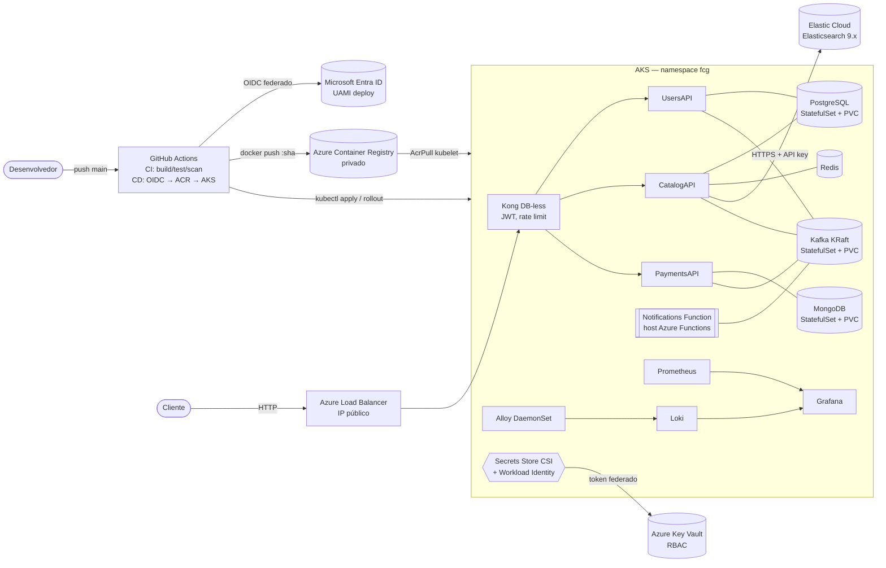

# Arquitetura — Inventário da Fase 3 e Arquitetura-alvo da Fase 4

## 1. Inventário da arquitetura atual (auditoria de 2026-11-17)

### Repositórios (todos em `main`, sincronizados com `origin`, árvore limpa)

| Repositório | HEAD auditado | Testes | Observações |
|---|---|---|---|
| `fiap-cloud-games-orchestration` | `a069dde` | — | Compose, k8s local, Kong, observabilidade, docs; tag `phase-2` |
| `fiap-cloud-games-users-api` | `3681486` | 21 ✔ | .NET 8, EF Core + PostgreSQL, emissão de JWT HS256, Kafka producer |
| `fiap-cloud-games-catalog-api` | `e3d03b3` | 22 ✔ | .NET 8, EF Core + Dapper, Redis cache-aside, Kafka producer/consumer |
| `fiap-cloud-games-payments-api` | `72bde0f` | 15 ✔ | .NET 8, MongoDB.Driver 3.11, Kafka consumer/producer |
| `fiap-cloud-games-notifications-function` | `0e7e956` | 13 ✔ | Azure Functions isolated (.NET 8), gatilhos Kafka |
| `fiap-cloud-games-notifications-api` | (não clonado) | — | Legado Fase 2, perfil `phase2-legacy` no Compose |

Nenhum repositório possui `.github/workflows`. Nenhum possui infraestrutura como código para nuvem.

### Componentes em execução (Compose / Kubernetes local)

| Componente | Imagem/versão | Persistência | Exposição |
|---|---|---|---|
| PostgreSQL | `postgres:16` | volume (Compose) / `emptyDir` (k8s) | interna |
| Kafka (KRaft, 1 broker) | `apache/kafka:3.9.0` | nenhuma | interna |
| Redis | `redis:7-alpine` | nenhuma, sem senha | interna |
| MongoDB | `mongo:7` | volume (Compose) / `emptyDir` (k8s) | interna |
| Kong DB-less | `kong:3.9` | — | `:8000` / NodePort 30080 |
| Prometheus | `prom/prometheus:v3.5.0` | efêmera | `:9090` / NodePort 30090 |
| Grafana | `grafana/grafana:12.1.0` | — | `:3000` / NodePort 30300 |
| Loki + Alloy | `grafana/loki:3.5.3`, `grafana/alloy:v1.11.0` | efêmera | **apenas Compose** |

### Contratos Kafka (preservar)

`fcg.users.created` (UserCreatedEvent), `fcg.orders.placed` (OrderPlacedEvent), `fcg.payments.processed`
(PaymentProcessedEvent); grupos `payments-service`, `catalog-service`, `notifications-function`.

### Autenticação

JWT HS256 simétrico emitido pela UsersAPI (`iss=FiapCloudGames`), validado pelo Kong (plugin `jwt`, consumidor
com `key = iss`) e novamente pelos serviços. Kong OSS 3.9 **não resolve referências de vault** em `jwt_secrets`,
portanto o segredo precisa estar literal no `kong.yml` carregado pelo processo.

### Credenciais de desenvolvimento e configurações inadequadas para produção

| Local | Item | Tratamento na Fase 4 |
|---|---|---|
| `orchestration/.env.example`, defaults do Compose | `POSTGRES_PASSWORD=fcg`, `MONGO_PASSWORD=fcg`, `JWT__SECRETKEY` placeholder, Grafana `admin/admin` | Mantidos **apenas** para execução local |
| `orchestration/k8s/shared-secret.yaml` | `Secret` com placeholders | Mantido para k8s local; **não usado** no AKS |
| `orchestration/gateway/kong.yml` | segredo JWT literal (placeholder) | No AKS o arquivo é renderizado no pod a partir do Key Vault |
| `*/appsettings*.json` | connection strings com `Password=fcg`, chave JWT placeholder | Mantidos para desenvolvimento; no AKS sobrescritos por segredos montados |
| `users-api/DbSeeder` | usuários semente com senhas fixas (`Admin@123`, `User@123`) | Senha do admin configurável; no AKS vem do Key Vault |
| Redis | sem autenticação | `requirepass` com segredo do Key Vault no AKS |
| Kong Admin API | exposta em `127.0.0.1` (Compose) / ClusterIP (k8s) | Continua sem exposição externa no AKS |
| Persistência | `emptyDir` para Postgres/Mongo; Kafka sem volume | PVC (`managed-csi`) no AKS |
| Imagens | tag `:local`, `imagePullPolicy: IfNotPresent` | Tag = SHA do commit no ACR |
| Swagger | habilitado em todos os ambientes, não roteado pelo Kong | Mantido (não exposto pelo gateway) |

## 2. Arquitetura-alvo (Azure)

### Responsabilidades por repositório na Fase 4

| Repositório | Responsabilidade adicional |
|---|---|
| `orchestration` | Terraform, manifests de plataforma do AKS (dados, Kong, observabilidade, ServiceAccounts, SecretProviderClasses), workflows reutilizáveis, scripts de provisionamento/smoke/destruição, documentação |
| `users-api`, `catalog-api`, `payments-api`, `notifications-function` | Manifests de workload para o AKS (`k8s/azure/`), workflow chamador de CI/CD |
| `catalog-api` | Busca avançada com Elasticsearch |

### Persistência poliglota

| Armazenamento | Dono | Uso |
|---|---|---|
| PostgreSQL | UsersAPI (`fcg_users`), CatalogAPI (`fcg_catalog`) | Fonte da verdade transacional |
| MongoDB | PaymentsAPI (`fcg_payments.payments`) | Histórico de pagamentos (documento por pedido) |
| Redis | CatalogAPI | Cache distribuído (cache-aside) |
| Elasticsearch | CatalogAPI (`fcg-games`) | Índice de busca derivado (consistência eventual) |
