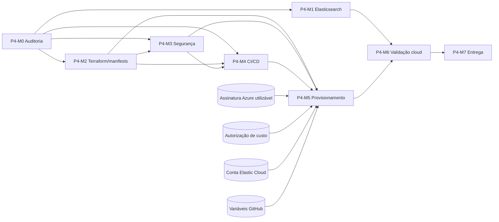

# Dependências entre Marcos e Externas

## Grafo

## Tabela refinada (pós-auditoria)

| Marco | Depende de | Pode avançar localmente? | Aprovação final exige |
|---|---|---|---|
| P4-M1 | M0 | **Sim, integralmente** (ES em container) | testes de integração + smoke local; validação no Elastic Cloud é feita no M6 |
| P4-M2 | M0 | Sim (`fmt`/`validate`, renderização) | provisionamento real é critério do M5 |
| P4-M3 | M0; integração com M2 | Sim (código, manifests, renderização) | segredos lidos em runtime no AKS (M5) |
| P4-M4 | M0; integração com M2/M3 | Sim — **CI executa de verdade no GitHub** (repos públicos) | CD executado no AKS (M5/M6) |
| P4-M5 | M2, M3, M4 + externas | Não | ambiente Azure funcional |
| P4-M6 | M1, M5, CD operacional | Não | evidências na nuvem |
| P4-M7 | evidências dos anteriores | Parcialmente (documentação) | evidências reais |

## Dependências externas

| ID | Dependência | Responsável | Situação |
|---|---|---|---|
| X1 | Assinatura Azure ativa (estado `Enabled`) com permissão Owner/Contributor + User Access Administrator | Proprietário | **BLOQUEADO** — estado `Warned` |
| X2 | Autorização explícita do custo estimado ([COSTS.md](COSTS.md)) | Proprietário | Pendente |
| X3 | Conta Elastic Cloud + deployment + API key | Proprietário (cadastro humano) | Pendente |
| X4 | Variáveis de repositório no GitHub (`AZURE_CLIENT_ID`, `AZURE_TENANT_ID`, `AZURE_SUBSCRIPTION_ID`, `ACR_NAME`, `AKS_NAME`, `AKS_RESOURCE_GROUP`, `AZURE_DEPLOY_ENABLED`) | Proprietário (ou `gh` autenticado) | Pendente (após M5) |
| X5 | Terraform CLI na estação do proprietário | Proprietário | Pendente (`winget install Hashicorp.Terraform`) |
| X6 | Dados do relatório (grupo, participantes, Discord, link do vídeo) | Proprietário | Pendente (M7) |
